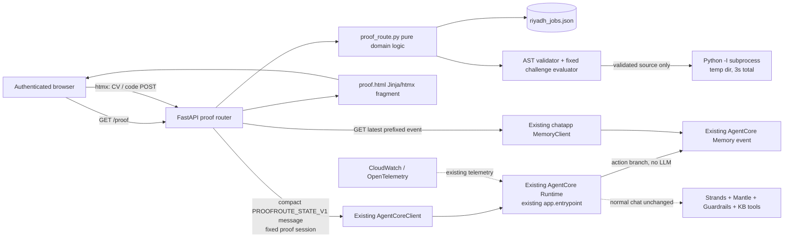
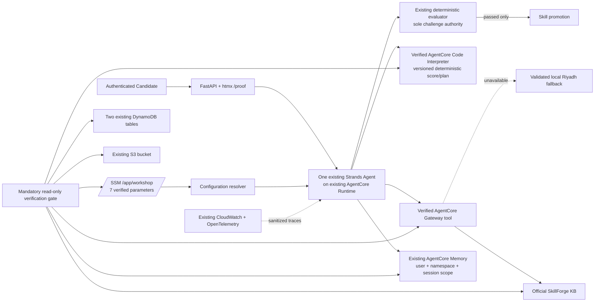

# ProofRoute MVP Design

> **Official SkillForge correction:** The sections titled **AWS SkillForge Correction** later in this document supersede any earlier local-only or second-entrypoint implication. Existing deterministic extraction, formulas, constrained evaluator, local fallback, and pass-gated transition remain valid. The correction adds verified SSM configuration, one-agent autonomous orchestration, official AgentCore Code Interpreter scoring/planning, SkillForge KB access through Gateway, per-user Memory scoping, and a mandatory read-only verification gate. No shared foundation resource is created or replaced.

## Overview

ProofRoute remains a dedicated authenticated `/proof` workflow and retains the implemented deterministic backend loop:

1. paste CV text;
2. deterministically extract a canonical skill profile;
3. obtain market evidence from the verified SkillForge Knowledge Base through AgentCore Gateway, with the validated local Riyadh dataset as an explicitly labeled fallback;
4. use the official Strands AgentCore Code Interpreter integration to execute versioned deterministic scoring, gap selection, and action-planning code;
5. present the fixed **Automated Testing** challenge;
6. evaluate the candidate test function with the existing constrained deterministic evaluator, which remains the sole pass/fail and promotion authority;
7. recompute and display before/after score and job matches; and
8. persist scoped progression through the existing AgentCore Memory resource.

One Strands agent on the existing AgentCore Runtime autonomously coordinates Gateway, Code Interpreter, deterministic evaluation, and Memory. LLM output does not perform arithmetic, invent market evidence, judge challenge code, or authorize a skill transition. Existing Cognito, Guardrails, observability, Runtime, Memory, Knowledge Base, Gateway, Code Interpreter, DynamoDB, and S3 resources are reused only after verification; the correction creates no duplicate shared infrastructure.

### Scope and requirement feasibility corrections

The approved requirements describe a broader product than can be implemented safely in 2.5 hours. This design uses the following explicit MVP interpretations:

- **Requirements 1, 3, 4, 5, 9, 10, and 12:** one target role (`Junior Backend Engineer — Riyadh`), a small canonical dictionary, one local dataset, one dashboard, and deterministic pure functions.
- **Requirement 2:** local structured JSON is authoritative for frequency/scoring. Existing Bedrock KB remains reusable for future explanations but is not queried by the MVP scoring path; KB document count and ingestion gating are deferred.
- **Requirement 6:** one immutable, hand-authored Automated Testing challenge replaces LLM challenge generation and challenge-per-skill generation.
- **Requirements 7 and 13:** execution is limited to an AST-validated test function in an isolated temporary directory and short subprocess. This is a demo containment boundary, **not** a production-grade hostile-code sandbox.
- **Requirement 8:** only a versioned compact snapshot is persisted as an AgentCore Memory conversational event. Rich semantic/episodic records, retries, and strong write/read timing guarantees are deferred.
- **Requirement 11:** the existing `@app.entrypoint` remains the sole entrypoint. A `PROOFROUTE_STATE_V1:` action prefix is handled before normal Strands/LLM orchestration, using the already verified agent-side Memory client. A second agent/entrypoint would add deployment uncertainty without improving the demo.
- Exact demo numbers `64 → 73` and `8 → 14` are fixture targets, not business invariants. Seed curation should target them, but if tuning exceeds 10 minutes, the cut is to preserve deterministic monotonic improvement rather than spend the MVP budget matching exact marketing numbers.

### Repository research findings

- `chatapp/app/auth/middleware.py` protects every non-public route, so `/proof` receives existing Cognito/dev-mode behavior without new auth code.
- `chatapp/app/templates/base.html` and `components/header.html` already provide theme, Tailwind utilities, htmx, responsive cards, and navigation; ProofRoute needs no new CSS/JS asset.
- `chatapp/app/main.py` owns router registration and app settings injection patterns.
- `chatapp/app/agentcore/client.py` already invokes the sole AgentCore Runtime and parses existing text/tool/guardrail events.
- `agent/my_agent.py` already has a configured `bedrock_agentcore.memory.MemoryClient` and calls `create_event`; `chatapp/app/agentcore/memory.py` already reads events with `list_events`.
- `chatapp/requirements.txt` already includes pytest, pytest-asyncio, and Hypothesis, so no dependency change is needed.
- `cdk/lib/bedrock-stack.ts` already deploys Memory, KB, and Guardrails; `foundation-stack.ts` already grants runtime, memory-read, KB, Cognito, and observability-related access. The MVP adds no resource.

## Architecture



### Architectural decisions

1. **Server-rendered htmx workflow:** each action returns the same `#proof-content` fragment from one Jinja template. No client state framework or custom JavaScript is required.
2. **One compact domain module:** dataclasses, extraction, frequency calculation, scoring, gap selection, matching, fixed challenge, validation, and evaluation stay together because splitting layers would consume the demo budget without reducing risk.
3. **One authoritative dataset:** all market frequency and job-match results derive from `riyadh_jobs.json`; semantic retrieval cannot change numeric output.
4. **Versioned event snapshot:** a compact JSON snapshot prefixed by `PROOFROUTE_STATE_V1:` is written under actor ID = Cognito user ID and fixed session ID = `proof-route-profile-v1`. A new browser session can retrieve the same stream.
5. **No LLM in correctness path:** the state-write action branches before model construction/invocation. Existing normal chat behavior remains unchanged.
6. **Fail closed:** invalid CV, invalid/unsafe code, evaluator failure, or persistence failure never promotes a skill. Persistence failure is displayed as a warning after keeping the current in-request result visible.

## Components and Interfaces

### Domain API (`chatapp/app/proof_route.py`)

The module exposes small typed functions; names are illustrative but form the intended implementation contract:

```python
load_jobs(path) -> tuple[Job, ...]
extract_profile(cv_text, jobs, target_role=TARGET_ROLE) -> SkillProfile
compute_market_frequencies(jobs) -> dict[str, int]
compute_readiness(profile) -> int
select_gap(profile) -> GapSelection | None
match_jobs(profile, jobs) -> tuple[JobMatch, ...]
evaluate_automated_testing(source) -> EvaluationResult
apply_pass(profile, evaluation) -> TransitionResult
snapshot_to_message(snapshot) -> str
snapshot_from_events(events) -> ProgressSnapshot | None
```

Canonical skill extraction uses case-insensitive escaped word/phrase matching against a constant synonym map. A claimed skill is `Demonstrated` only when the same sentence contains a conservative evidence marker (named project/repository URL, role/certification marker, implementation verb, or numeric outcome); otherwise it is `Unverified`. Any dataset skill with frequency at least 40 that is absent is `Missing`. Duplicate synonyms collapse to one canonical skill.

### HTTP interface (`chatapp/app/routes/proof.py`)

- `GET /proof`: load the latest valid snapshot for the authenticated user, or show the CV form.
- `POST /proof/profile`: validate 50–10,000 characters, extract profile, compute score/gap/matches, persist snapshot, and return the content fragment.
- `POST /proof/evaluate`: validate code length 1–10,000, evaluate the fixed challenge, apply transition only on pass, persist outcome/snapshot, and return the content fragment with before/after data.

The router gets `user_id` from `request.state.user`, uses a module-level read-only job tuple, and consumes the existing `AgentCoreClient.invoke_stream(...)` only for the special state-write message. Retrieval uses existing `MemoryClient.get_events(...)`. Endpoints return a complete page for normal navigation and only the `#proof-content` fragment when `HX-Request` is present.

### Fixed challenge and evaluator

The single challenge asks the candidate to write a function with this shape:

```python
def test_normalize_status(normalize_status):
    # candidate assertions
```

The supplied contract says `normalize_status(value)` trims surrounding whitespace, lowercases text, maps `"ok"` to `"passed"`, maps `"error"` to `"failed"`, and rejects non-strings. Candidate code is expected to assert the contract.

Evaluation steps:

1. reject empty or over-10,000-character source;
2. parse with `ast.parse`;
3. require exactly one function named `test_normalize_status` with one parameter;
4. allow only a narrow AST subset needed for assertions, literals, comparisons, boolean expressions, and calls to that parameter; reject imports, attributes, globals, comprehensions, lambdas, classes, async/yield, dunder names, file/network/process access, and arbitrary calls;
5. write a generated harness and candidate function to a `tempfile.TemporaryDirectory` with owner-only permissions where supported;
6. run `sys.executable -I` once with captured stdout/stderr and a 3-second total timeout;
7. inject one correct implementation and fixed hidden mutants (no trim, no lowercase, wrong mapping, no type rejection);
8. pass only when candidate assertions accept the correct implementation and reject every mutant;
9. return structured per-mutant status, bounded output, and a deterministic first-failure hint; and
10. delete the directory automatically on all paths.

This is not a general Python runner. The AST allowlist is the primary MVP control and intentionally limits submissions to assertions over the injected callable. Production execution of hostile code remains deferred to a dedicated isolation boundary.

### AgentCore Memory interface

- Write message: `PROOFROUTE_STATE_V1:{compact-json}`.
- Actor ID: authenticated Cognito user ID.
- Session ID: constant `proof-route-profile-v1` so browser session IDs do not fragment progression.
- Agent behavior: `agent/my_agent.py` detects the prefix before model construction, validates JSON shape/size, calls the already configured `MemoryClient.create_event(...)`, emits an existing text event acknowledgement, and returns.
- Read behavior: the chatapp's existing `MemoryClient.get_events(...)` lists the fixed session; `snapshot_from_events` scans newest-to-oldest user messages, accepts the first valid versioned snapshot, and ignores malformed/unrelated events.
- Stored fields only: target role, canonical skill records, completed fixed challenge outcome, latest score, latest match count, and UTC update timestamp.

Future semantic memory records, per-challenge repositories, direct chatapp writes, migration tooling, and cross-device conflict resolution are deferred.

## Exact File Reuse and Change Map

Every file/component touched or intentionally considered for this MVP is classified below. Estimates are implementation estimates, not design-document time.

| Component / exact file | Classification | Time | Complexity | Risk | MVP treatment |
|---|---|---:|---|---|---|
| Sole runtime entrypoint and state action — `agent/my_agent.py` | **MODIFY existing** | 12 min | Low | Medium | Add an early, prefix-gated state snapshot branch using the existing `_memory_client.create_event`; leave normal agent, tools, MemoryHook, model routing, and streaming unchanged. |
| Proof domain logic — `chatapp/app/proof_route.py` | **ADD new** | 25 min max | Medium | Medium | One compact module for models, extraction, scoring, matching, snapshot codec, and fixed evaluator. If it exceeds 25 min, cut exact demo-number tuning and detailed hints—not deterministic pass/fail. |
| Curated market data — `chatapp/app/data/riyadh_jobs.json` | **ADD new** | 10 min | Low | Low | 12–20 synthetic/curated representative job records with title and canonical required skills; no scraper or ingestion wait. |
| Proof HTTP flow — `chatapp/app/routes/proof.py` | **ADD new** | 20 min | Medium | Medium | Three routes, htmx fragment rendering, existing auth state, existing AgentCore and Memory clients. No service/repository layer. |
| Router registration — `chatapp/app/main.py` | **MODIFY existing** | 2 min | Low | Low | Import and include `proof_router`; no other lifecycle/config changes. |
| Dashboard — `chatapp/app/templates/proof.html` | **ADD new** | 20 min | Low | Low | One template/macro for full page and htmx fragment; reuse base/header/Tailwind. |
| Focused tests — `chatapp/tests/test_proof_route.py` | **ADD new** | 20 min | Medium | Low | Unit + Hypothesis tests for pure logic and fixed evaluator; one lightweight route smoke test only if time remains. |
| Continuity note — `docs/PROJECT_STATE.md` | **ADD new** | 5 min | Low | Low | Record current design decision, scope, files, invariants, and next implementation order. |
| Base theme/htmx shell — `chatapp/app/templates/base.html` | **REUSE unchanged** | — | — | Low | Existing htmx, Tailwind, theme, and responsive tokens are sufficient. |
| Shared header — `chatapp/app/templates/components/header.html` | **REUSE unchanged** | — | — | Low | Include with ProofRoute title/back-to-chat context; no new global navigation required for demo. |
| Cognito/dev auth — `chatapp/app/auth/middleware.py` | **REUSE unchanged** | — | — | Low | `/proof` is protected because it is not public. |
| Runtime invocation — `chatapp/app/agentcore/client.py` | **REUSE unchanged** | — | — | Medium | Send the prefixed snapshot through the existing `prompt` field and fixed runtime session ID; no payload/API extension. |
| Memory event retrieval — `chatapp/app/agentcore/memory.py` | **REUSE unchanged** | — | — | Medium | Existing `get_events` is sufficient; parse the versioned message in the domain module. |
| SSE models — `chatapp/app/models/events.py` | **REUSE unchanged** | — | — | Low | Existing `TextStreamEvent` parsing and `DoneEvent` are sufficient for acknowledgement consumption. |
| Agent configuration — `agent/config.py` | **REUSE unchanged** | — | — | Low | Reuse current Memory ID, region, model, and guardrail variables; add none. |
| Conversation `MemoryHook` — `agent/my_agent.py` existing class | **REUSE unchanged** | — | — | Low | Normal chat memory remains intact; special snapshot branch writes one explicit event before constructing an agent. |
| Bedrock guardrail hook — `agent/guardrails.py` | **REUSE unchanged** | — | — | Low | Continues to cover existing LLM calls; ProofRoute deterministic action makes no LLM call. |
| KB tool — `agent/tools/knowledge_base.py` | **REUSE unchanged** | — | — | Low | Available to normal chat; excluded from scoring/evaluation. |
| Existing app configuration — `chatapp/app/config.py` | **REUSE unchanged** | — | — | Low | No new environment variables. |
| Existing dependencies — `chatapp/requirements.txt`, `agent/requirements.txt` | **REUSE unchanged** | — | — | Low | Hypothesis, pytest, AgentCore, boto3, FastAPI, and Jinja are already present. |
| Existing AWS resources — `cdk/lib/bedrock-stack.ts`, `cdk/lib/foundation-stack.ts`, `cdk/lib/agent-stack.ts`, `cdk/lib/chatapp-stack.ts` | **REUSE unchanged** | — | — | Low | Runtime, Memory, KB, Guardrails, Cognito, CloudWatch/OpenTelemetry, and app deployment are reused. |
| Dedicated ProofRoute agent/entrypoint | **DEFER** | — | — | High | Requirement 11 is reduced to mode/action routing in the one deployed entrypoint; a second entrypoint risks unsupported dispatch/deployment behavior. |
| KB job seed documents and scoring via retrieval | **DEFER** | — | — | High | Avoid ingestion timing and incomplete semantic retrieval. Optional explanatory duplication can follow the demo. |
| New stylesheet or JavaScript asset | **DEFER** | — | — | Low | Existing utility classes and htmx attributes are enough. |
| Repositories/services/database tables/custom analytics | **DEFER** | — | — | Medium | No value for the closed loop; would force infrastructure and abstraction work. |
| General challenge generation and multiple skill challenges | **DEFER** | — | — | High | Fixed Automated Testing challenge only. |
| Production hostile-code sandbox | **DEFER** | — | — | High | Requires a separate isolation boundary and security review; AST-constrained demo evaluator is explicitly non-production. |
| CV upload/OCR, live job scraping, job APIs | **DEFER** | — | — | High | Pasted text and local data only. |
| Strong Memory SLAs, retries, semantic/episodic schemas | **DEFER** | — | — | Medium | Best-effort versioned event snapshot only for MVP. |

Estimated implementation total: **approximately 114 minutes**, leaving roughly 36 minutes for running tests, fixing integration issues, and demo rehearsal. No individual ADD/MODIFY item exceeds 25 minutes.

## Data Models

The implementation should use frozen/regular dataclasses and enums in the single domain module, serialized explicitly to plain JSON-compatible dictionaries.

```text
SkillState = Demonstrated | Unverified | Missing

Job
- id: str
- title: str
- location: str                  # fixed Riyadh/Saudi labels
- required_skills: tuple[str]

SkillRecord
- name: str                      # canonical, non-empty
- state: SkillState
- market_frequency: int          # 0..100
- priority_score: float          # 0..100
- evidence: str                  # <=300 chars for CV, outcome ID after pass, empty if Missing

SkillProfile
- target_role: str
- skills: tuple[SkillRecord]

GapSelection
- skill_name: str
- state: SkillState
- market_frequency: int
- priority_score: float
- rationale: str                 # deterministic template, not LLM text

JobMatch
- job_id: str
- title: str
- coverage: float                # demonstrated required / total required
- matched: bool                  # coverage >= 0.60

TestCaseResult
- name: str                      # correct or hidden-mutant identifier
- status: passed | failed | timeout | error
- detail: str

EvaluationResult
- status: passed | failed | error
- skill_name: str                # always Automated Testing
- cases: tuple[TestCaseResult]
- hint: str
- stdout: str                    # truncated
- stderr: str                    # truncated
- outcome_id: str                # deterministic hash or UUID generated after execution

ProgressSnapshot (schema_version = 1)
- target_role: str
- skills: tuple[SkillRecord]
- completed_challenge: {outcome_id, skill_name, status, updated_at} | null
- latest_score: int
- latest_match_count: int
- updated_at: UTC ISO-8601 string

TransitionResult
- profile: SkillProfile
- previous_score: int
- new_score: int
- score_delta: int
- previous_match_count: int
- new_match_count: int
- demonstrated_skill: str
```

### Deterministic scoring

For market skills with positive frequency:

```text
readiness = clamp(
  round(100 × sum(frequency of Demonstrated skills)
            / sum(frequency of all profile skills with frequency > 0)),
  0,
  100
)
```

If the denominator is zero, return `0`. Canonical deduplication guarantees each skill contributes once. Transitioning one existing skill to `Demonstrated` changes only the numerator, so readiness cannot decrease.

### Deterministic gap selection

For every non-Demonstrated skill with an integer market frequency:

```text
priority = market_frequency × (1.0 if state == Missing else 0.7)
```

Sort by `(-priority, canonical_name.casefold(), canonical_name)` and select the first. If none exist, return `None`. The rationale is a fixed template that names the frequency and state multiplier. Skills lacking frequency are omitted and returned as unscored only in future broader profiles; the local MVP dataset always supplies frequencies.

### Deterministic market frequency and matches

- Frequency: `round(100 × jobs_mentioning_skill / total_jobs)` using the loaded JSON tuple.
- Match coverage: `count(required_skills ∩ demonstrated_skills) / count(required_skills)`.
- A job is matched at coverage `>= 0.60`; zero-skill jobs are invalid seed data.
- Job matches sort by `(-coverage, title.casefold(), id)`; UI shows the first 10.
- Demonstrating a skill can only add to the demonstrated set, so each job's coverage and total matched count are monotonic non-decreasing.

The JSON seed and a fixed demo CV fixture should be curated so Automated Testing is the highest-impact initial gap and ideally yields the `64 → 73`, `8 → 14` showcase. Exact numbers are a seed-fixture concern, not hard-coded branches in scoring.


## Correctness Properties

*A property is a characteristic or behavior that should hold true across all valid executions of a system-essentially, a formal statement about what the system should do. Properties serve as the bridge between human-readable specifications and machine-verifiable correctness guarantees.*

The prework reflection consolidated logically overlapping criteria: evidence-state clauses are one classifier property; frequency/range clauses are one aggregate property; formula/determinism clauses are one scoring property; priority/tie/reproducibility clauses are one selection property; promotion, score diff, and authorization clauses are one transition property; and matching reference/monotonicity clauses are one property. UI, AWS, timing, and production-sandbox claims remain example or integration tests.

### Property 1: Canonical profile derivation is valid and evidence-aware

For all valid CV texts assembled from configured skill synonyms, whitespace/case variants, and sentences with or without evidence markers, extraction produces at most one non-empty canonical record per skill; claimed skills with a same-sentence artifact marker are `Demonstrated`, claimed skills without one are `Unverified`, absent market skills at or above the missing threshold are `Missing`, and every evidence snippet is a substring of the CV bounded to 300 characters.

**Validates: Requirements 1.2, 1.3, 2.3, 3.1, 3.2, 3.3, 3.4, 12.1, 12.3, 12.4, 12.5**

### Property 2: Market frequencies equal the reference percentage

For all non-empty valid job datasets and canonical skills, computed market frequency equals `round(100 × mentioning_jobs / total_jobs)` and is an integer from 0 through 100 inclusive.

**Validates: Requirements 2.2, 2.4**

### Property 3: Readiness equals the weighted reference and is deterministic

For all valid skill profiles, readiness is zero when no positive market weight exists; otherwise it equals the clamped rounded weighted formula in Requirement 4.1, and repeated calls with the same profile return the same value.

**Validates: Requirements 4.1, 4.2, 4.3**

### Property 4: Gap selection follows priority and deterministic ordering

For all valid profiles, gap selection returns `None` exactly when no non-Demonstrated scored skill exists; otherwise it returns the first candidate ordered by descending `market_frequency × state_multiplier` and ascending canonical name, and repeated calls return the same result.

**Validates: Requirements 5.1, 5.2, 5.3, 5.4**

### Property 5: Only passing evidence promotes and promotion cannot lower readiness

For all valid profiles and evaluation results, a non-passing result leaves every skill state and score unchanged; a passing result for the fixed Automated Testing challenge changes only that skill to `Demonstrated`, attaches its outcome ID, recomputes the score, and produces `new_score >= previous_score` with `delta = new_score - previous_score`.

**Validates: Requirements 3.5, 4.4, 7.6, 9.1, 9.4**

### Property 6: Demonstration cannot reduce deterministic job matches

For all valid job datasets, profiles, and valid promotions, every job's demonstrated-skill coverage after promotion is greater than or equal to its previous coverage, and the count of jobs meeting the 60% match threshold cannot decrease.

**Validates: Requirements 9.2, 9.3**

### Property 7: Progress snapshot message round-trip preserves progression

For all valid schema-version-1 progress snapshots, encoding to a prefixed compact message and decoding that message yields an equivalent target role, canonical skill states/evidence, completed challenge outcome, score, and match count; malformed, unrelated, or unsupported-version messages never produce a snapshot.

**Validates: Requirements 3.7, 8.4**

### Property 8: The fixed evaluator is deterministic, bounded, and fail-closed

For all AST-accepted candidate test functions generated from permitted assertions, repeated evaluation against the same correct implementation and hidden mutants returns the same pass/fail classification; `passed` occurs only when the correct implementation is accepted and every required mutant is rejected; all results include the fixed skill name and structured cases; and captured stdout/stderr are each at most 10,000 characters.

**Validates: Requirements 6.4, 7.2, 7.4, 7.5, 13.4**

## Error Handling

| Failure | Behavior | State safety |
|---|---|---|
| CV length outside 50–10,000 | Return an htmx validation fragment; echo submitted text and do not call extraction/persistence. | Existing snapshot unchanged. |
| Dataset missing/malformed/empty | Log server error and show “market data unavailable”; disable profile creation/evaluation. | No guessed score or transition. |
| No extracted claims | Show actionable validation (“include skills/projects”) rather than constructing an empty demo profile. | No persisted replacement. |
| Memory read unavailable | Show a non-blocking load error and CV restart action. | Do not fabricate restored progress. |
| Memory write/action failure | Keep the current response visible with “progress not saved” warning and allow retry/resubmit. | Never claim persistence; no extra promotion occurs. |
| Empty/oversized or syntax-invalid code | Return structured `failed` result without starting subprocess. | Skill remains unchanged. |
| AST policy violation | Return deterministic rejection naming the unsupported construct. | Skill remains unchanged. |
| Subprocess timeout | Kill the process where supported, return `failed/timeout`, truncate output, clean temp directory. | Skill remains unchanged. |
| Subprocess start/non-zero/harness error | Return `error` with bounded stderr and clean temp directory. | Skill remains unchanged. |
| Passing evaluation but snapshot write fails | Display pass and local before/after plus persistence warning. A reload may return the prior snapshot. | No false “saved” status; candidate can retry. |
| Unexpected route exception | Log through existing application/CloudWatch path and return a compact error fragment. | Never transition in exception handlers. |

The MVP deliberately does not promise the original 5/10/30-second service SLAs or three-write retry loop. Pure calculations should complete in milliseconds; runtime/Memory calls use existing client behavior and surface failure. Production retry/idempotency would be a later design.

## Testing Strategy

### Property-based tests

Use the already installed **Hypothesis** library. Each of the eight properties above maps to exactly one test, runs at least 100 generated examples (`@settings(max_examples=100)` or more), and carries a comment in this format:

```python
# Feature: proof-route, Property 3: Readiness equals the weighted reference and is deterministic
```

Generators should build small canonical job sets, unique skill profiles, evidence/no-evidence CV sentences, valid promotions, snapshot records, and only AST-safe candidate assertion templates. Keep subprocess use out of most generated cases: Property 8 may test a pure evaluator policy/oracle over generated assertion specifications and use a small example-based subprocess corpus, avoiding 100 process launches while still validating the universal deterministic contract.

### Example and edge-case unit tests

Keep the example suite intentionally small:

- CV lengths 0, 49, 50, 10,000, and 10,001;
- zero-frequency profile returns readiness 0;
- all skills Demonstrated returns no gap;
- synonym/case/whitespace examples;
- fixed challenge definition contains its contract/examples/pass criteria;
- one adequate candidate rejects all hidden mutants;
- one weak candidate misses a mutant;
- syntax error, forbidden import/attribute, timeout, and mocked subprocess startup failure;
- snapshot scan ignores malformed/newer unrelated messages and restores the latest valid snapshot;
- no-profile page renders only the CV CTA;
- populated/result page exposes three state groups, gap, challenge, per-case result, diff, and top jobs.

### Integration and manual smoke tests

- FastAPI TestClient: unauthenticated `/proof` redirects; dev/authenticated GET returns 200; htmx POST returns the fragment marker.
- AgentCore deployed smoke: write a snapshot under `proof-route-profile-v1`, start a new browser session for the same user, and verify restoration.
- Browser smoke at 1280px: no horizontal scroll, htmx indicator appears during requests, and the closed loop completes.
- Observability smoke: existing runtime logs/traces record the state action; no custom metric/dashboard work.
- Security smoke: temporary directory is removed on pass/fail/error, mode is owner-only where supported, forbidden AST examples never invoke subprocess, and output is bounded.

A full production security claim is explicitly out of scope; passing these tests does not convert the demo evaluator into a multi-tenant sandbox.

## UI Flow

1. **GET `/proof`, no snapshot:** shared header + one card with target role label, CV textarea, live native/inline character count, and “Analyze profile.” No downstream cards render.
2. **Profile response:** replace `#proof-content` with readiness gauge/number, three grouped skill columns (`Demonstrated`, `Unverified`, `Missing`), highest-impact gap/rationale, and top 1–10 job matches.
3. **Challenge:** when Automated Testing is the selected/available gap, show the fixed statement, contract/examples, code textarea, and “Run proof.” If a different gap ranks first, the MVP still highlights it but offers the only challenge as “Prove Automated Testing” with transparent labeling; multi-skill challenge generation is deferred.
4. **Evaluation in flight:** standard `hx-indicator` spinner within the challenge card; the server evaluates once.
5. **Failure:** show overall failed status, per-mutant checks, deterministic hint, and keep the code for editing.
6. **Pass:** show passed status, transition Automated Testing to Demonstrated, before/after score and job-match count, delta, and updated next gap.
7. **New browser session:** GET reads the fixed Memory session and restores the latest valid snapshot; code text itself is not persisted.

The template uses existing responsive grid/card utilities and one scrollable page. It introduces no bespoke stylesheet, JavaScript state machine, modal, editor, chart library, or upload control.

## AWS Service Mapping

| AWS/existing capability | MVP use | Classification |
|---|---|---|
| Cognito + `AuthMiddleware` | Protect page and API routes; actor ID comes from verified user state. | **REUSE unchanged** |
| AgentCore Runtime | Receives the versioned state action through the existing runtime ARN/entrypoint. | **REUSE unchanged** |
| AgentCore Memory | Stores and lists compact conversational snapshot events under fixed proof session. | **REUSE unchanged** |
| Strands agent | Existing chat path remains operational; ProofRoute state action branches before model construction. | **REUSE unchanged** |
| Bedrock Guardrails | Continue unchanged for all existing LLM calls; deterministic ProofRoute calls no model. | **REUSE unchanged** |
| Bedrock Knowledge Base | Remains available for normal agent explanations, but is not authoritative for MVP scoring. | **REUSE unchanged** |
| S3 Vectors / KB source bucket | No ProofRoute seed upload or ingestion dependency. | **DEFER** |
| CloudWatch / OpenTelemetry | Existing logs/traces only; no ProofRoute analytics schema. | **REUSE unchanged** |
| ECS/Lambda app deployment and Agent container | Host existing FastAPI and runtime code changes. | **REUSE unchanged** |
| DynamoDB tables | Not used for ProofRoute progression. | **REUSE unchanged** |
| New queues, tables, buckets, functions, roles, or secrets | Not needed. | **DEFER** |

## Risk and Cut List

| Priority | Risk | Mitigation | Cut trigger / reduced behavior |
|---:|---|---|---|
| 1 | Arbitrary Python cannot be made production-safe in 25 minutes. | Narrow AST allowlist, injected callable only, `-I`, temp directory, 3-second timeout, bounded output. | If safe allowlist is not complete in 20 minutes, accept a structured list of assertions/cases instead of Python source; never ship unrestricted execution. |
| 2 | AgentCore Memory event action/retrieval may differ in deployed SDK behavior. | Use only the already observed `create_event` and `list_events` patterns, fixed session, versioned prefix, visible warning. | If integration takes >20 minutes, keep the loop functional in-request and clearly mark reload persistence unavailable; do not add a database. |
| 3 | Exact `64→73` and `8→14` seed tuning can consume time. | Keep formulas fixed and tune only JSON/demo CV. | Stop after 10 minutes; demonstrate monotonic numeric improvement instead. |
| 4 | Route + htmx partial mechanics can sprawl. | One router, one template macro, whole `#proof-content` replacement. | Return full page responses after POST if fragment rendering costs >20 minutes; functional loop beats polish. |
| 5 | Deterministic extraction may miss natural CV phrasing. | Small disclosed synonym/evidence dictionary tailored to demo persona. | Add only synonyms needed for the demo; no LLM fallback in numeric path. |
| 6 | Automated Testing may not be top gap for arbitrary CVs. | Curate demo CV/data and always label the fixed challenge honestly. | Do not build challenge generation; highlight computed gap and offer the fixed proof separately. |
| 7 | Requirement set implies strong SLAs/retries/rich Memory. | Document reduced event-snapshot semantics and fail closed. | Defer all retries, semantic schemas, conflict handling, and timing claims. |
| 8 | UI polish threatens the closed loop. | Existing base/header/Tailwind only. | Cut gauge graphics to a numeric score + progress bar; cut animations/custom CSS first. |
| 9 | Broad test matrix exceeds 20 minutes. | Prioritize pure function properties, evaluator rejection/pass examples, and one route smoke. | Cut visual automation and deployed Memory automation; retain manual smoke checklist. |

### Hard MVP cut order

If implementation runs late, cut in this order: exact target numbers → visual gauge styling → top-job detail fields → live character-count JavaScript (retain server validation) → persistence retry/polish → agent acknowledgement narration. Never cut deterministic scoring, deterministic gap selection, fixed hidden tests, pass-gated transition, before/after diff, or fail-closed behavior.

## Recommended Implementation Order

1. **0–10 min — seed and contracts:** add `riyadh_jobs.json`; define canonical skills, fixed challenge, and demo CV expected output.
2. **10–35 min — pure domain core:** implement models, extraction, frequency, readiness, gap, matching, transition, and snapshot codec in `proof_route.py`.
3. **35–55 min — constrained evaluator:** implement AST policy, hidden mutants, harness, timeout/output bounds, and known pass/fail checks. Apply the structured-assertions fallback immediately if the security allowlist exceeds the budget.
4. **55–67 min — Memory action:** add the early `PROOFROUTE_STATE_V1:` branch to `agent/my_agent.py`; do not modify normal agent construction or tools.
5. **67–89 min — HTTP integration:** add `routes/proof.py`, fixed proof session persistence/retrieval helpers, validation, and register the router in `main.py`.
6. **89–109 min — one-page UI:** add `proof.html` with htmx whole-content replacement and existing components/utilities.
7. **109–129 min — focused tests:** implement the eight consolidated Hypothesis properties where practical plus evaluator and route edge examples. If time is short, prioritize Properties 3–6 and evaluator fail-closed examples.
8. **129–140 min — integration fixes:** run targeted pytest, syntax/import checks, and one local TestClient loop.
9. **140–150 min — demo rehearsal:** run CV → profile → challenge fail → challenge pass → diff → reload; apply the cut list rather than adding abstractions.

This ordering establishes deterministic business value before UI or AWS integration and preserves a runnable in-request loop even if Memory integration is the only deferred piece.


---

# AWS SkillForge Correction

## Overview

This correction is an integration amendment, not a restart. `chatapp/app/proof_route.py`, `chatapp/app/routes/proof.py`, and router registration described in `docs/PROJECT_STATE.md` remain completed backend context. The deterministic formulas, canonicalization, fixed challenge, AST policy, hidden mutants, fail-closed promotion, snapshot codec, and temporary local market fallback remain valid.

The corrected target is one autonomous Strands agent using verified shared SkillForge resources:

- **AgentCore Gateway** exposes the official SkillForge managed Knowledge Base as the primary market tool.
- **AgentCore Code Interpreter** executes versioned deterministic Python for readiness, market aggregation, gap ordering, job matching, and next-action planning. It is a managed calculation tool, not an LLM arithmetic prompt and not the challenge judge.
- **The existing deterministic evaluator** remains the only authority for challenge pass/fail and skill promotion.
- **AgentCore Memory** stores progression under an authenticated per-user scope.
- **SSM Parameter Store** is the configuration authority for seven SkillForge resource roles.
- **The existing local dataset** remains a transparent fallback and must never be described as AWS-retrieved data.

The correction adds no duplicate Runtime, Memory, Code Interpreter, Gateway, Knowledge Base, DynamoDB table, S3 bucket, Cognito resource, Guardrail, or observability stack.

## Research Findings

The local repository contains no occurrences of `SkillForge`, `/app/workshop`, `citypulse`, or an AgentCore Code Interpreter configuration, so exact parameter paths and values cannot be truthfully inferred from source. They must be discovered and verified from the authorized SkillForge environment. Existing scripts already support named AWS profiles, while repository deployment defaults vary by script; the verification gate therefore pins every SkillForge check to `us-west-2` explicitly.

Official AWS documentation confirms the integration primitives used by this correction:

- [AgentCore Code Interpreter getting started](https://docs.aws.amazon.com/bedrock-agentcore/latest/devguide/code-interpreter-getting-started.html) describes managed Python execution for calculations and validation.
- [Using AgentCore Code Interpreter via AWS Strands](https://docs.aws.amazon.com/bedrock-agentcore/latest/devguide/code-interpreter-using-strands.html) documents the supported Strands integration path.
- [Connect a managed Knowledge Base through AgentCore Gateway](https://docs.aws.amazon.com/bedrock/latest/userguide/kb-gateway-target.html) documents exposing a Bedrock Knowledge Base as an MCP tool.
- [AgentCore Gateway managed Knowledge Base connector](https://docs.aws.amazon.com/bedrock-agentcore/latest/devguide/gateway-target-connector-managed-kb.html) documents the native connector used instead of a custom retrieval service.

Content from official AWS sources is summarized and rephrased for compliance with licensing restrictions.

## Architecture



### Corrected authority boundaries

1. **Agent orchestration authority:** one existing Strands agent decides which verified tool to call next and validates every structured tool result. A second agent or runtime is forbidden.
2. **Market authority:** verified SkillForge KB evidence through Gateway is primary. The local JSON dataset is a labeled availability fallback, not a simulated KB.
3. **Calculation authority:** Code Interpreter executes a versioned deterministic Python calculation bundle. LLM prose may explain results but cannot calculate or override them. The existing pure functions remain the local fallback and reference oracle.
4. **Evaluation authority:** the constrained deterministic evaluator alone decides whether candidate challenge evidence passes. Code Interpreter must never grade candidate code or authorize state promotion.
5. **Persistence authority:** AgentCore Memory stores versioned records scoped by authenticated user ID, `proof-route` namespace, and ProofRoute session. No default/shared actor is allowed.
6. **Configuration authority:** the seven exact SSM paths found in the official SkillForge environment are authoritative. The logical role list is fixed, but parameter paths and values are not guessed.
7. **Verification authority:** sanitized output from read-only AWS APIs is required before claiming a resource is available. Failed credential checks are credential blockers, not evidence that resources are missing.

## Mandatory Verification Gate

The gate runs after the current integration batch and before any new feature or infrastructure work. It is deliberately non-mutating.

### Gate sequence

1. Detect available named profiles using AWS CLI configuration metadata. Do not inspect credential files or print token/key material.
2. Select the profile authorized for SkillForge. User-provided `citypulse` commands are examples only and must not override verified SkillForge configuration.
3. Export or pass `AWS_PROFILE=<selected>` and `AWS_REGION=us-west-2`/`--region us-west-2` to every check.
4. Run STS `GetCallerIdentity`. Record only profile, region, account ID, principal ARN, timestamp, and status.
5. List SSM parameter metadata recursively under `/app/workshop` without decryption or values.
6. Reconcile exactly seven official SkillForge paths to these logical roles: Code Interpreter, Gateway, Knowledge Base, Memory, DynamoDB table A, DynamoDB table B, and S3 bucket. Record the exact names in `docs/PROJECT_STATE.md` only after discovery.
7. Resolve each parameter for programmatic validation while suppressing values from terminal transcripts, logs, task output, and documentation. Validate resource type and identifier shape in memory.
8. Use official read-only APIs to verify Code Interpreter, Gateway, Memory, and Knowledge Base. Require the SkillForge KB status to be `ACTIVE`.
9. Use non-mutating DynamoDB operations such as `DescribeTable` and bounded read authorization checks for both tables.
10. Use non-mutating S3 metadata/list authorization checks for the bucket; do not upload, overwrite, or delete objects.
11. Inspect existing stack/resource metadata for overlap. Document overlap and ownership; do not deploy, import, recreate, replace, or delete anything.
12. Write a sanitized PASS/BLOCKED report to `docs/PROJECT_STATE.md`. Dependent implementation begins only after PASS.

### Credential-first failure handling

Authentication, SSO, credential-process, expired-token, signature, and authorization errors stop the gate. The report includes the exact failing command with placeholders, sanitized error category, selected profile, region, and manual refresh commands appropriate to the detected profile, for example:

```powershell
aws configure list-profiles
aws sso login --profile <skillforge-profile>
aws sts get-caller-identity --profile <skillforge-profile> --region us-west-2
```

For non-SSO credentials, the report instructs the operator to refresh through the organization's approved credential provider; it never requests or records keys. No task may convert a credential failure into a resource deployment proposal or a PASS claim.

### Gate evidence schema

```text
VerificationEvidence
- checked_at: UTC timestamp
- profile_name: non-secret string
- region: "us-west-2"
- account_id: string                    # only after STS succeeds
- principal_arn: string                 # only after STS succeeds
- parameters: 7 × {name, logical_role, metadata, status}
- resources: {logical_role, type, status, sanitized_diagnostics}[]
- skillforge_kb_status: "ACTIVE" | blocked | unexpected
- overlap: {type, identifier_fingerprint, owner_evidence, action="reuse-only"}[]
- gate_status: PASS | BLOCKED
- blockers: {command_template, category, remediation}[]
```

Resource values are not persisted in this report. A one-way short fingerprint may be stored when needed to distinguish overlap without exposing a full sensitive identifier.

## Components and Interfaces

### SkillForge configuration resolver

A small typed resolver in the agent configuration boundary reads the seven exact parameter paths from a checked-in **name-only manifest** created after discovery. The manifest contains SSM path and logical role, never resolved values. Runtime resolution uses `us-west-2`, validates one-to-one roles, and returns an immutable configuration object. Missing, duplicate, malformed, or wrong-type entries fail closed.

```python
@dataclass(frozen=True)
class SkillForgeConfig:
    code_interpreter_id: str
    gateway_id_or_url: str
    knowledge_base_id: str
    memory_id: str
    profile_table_name: str
    progression_table_name: str
    market_bucket_name: str
    region: str = "us-west-2"
```

Field names are logical application names, not claims about actual SSM suffixes. Exact paths are discovered by the gate.

### One-agent orchestration interface

The existing entrypoint constructs one Strands agent with tools for:

- market retrieval through the verified Gateway MCP tool;
- exact calculation/planning through AgentCore Code Interpreter;
- the existing deterministic challenge evaluator;
- scoped Memory read/write; and
- existing deterministic parsing/profile operations.

The ProofRoute system prompt defines authority boundaries and requires structured outputs. Orchestration validates each result before the next call. Existing stream event types and Guardrail hooks remain unchanged. The existing prefix-based snapshot action may remain as a compatibility path, but it is not a second agent and cannot bypass user scoping or structured validation.

### Code Interpreter calculation contract

The agent sends bounded normalized data, never raw credentials or environment dumps:

```text
CalculationRequest
- schema_version
- calculation_version
- input_digest
- canonical_skill_records
- validated_market_records
- prior_score
- prior_match_count
- market_source: skillforge-kb | local-fallback
```

The versioned Python bundle implements existing frequency, readiness, priority, tie-break, matching, monotonicity, and ordered-next-action rules. It returns:

```text
CalculationResult
- schema_version
- calculation_version
- input_digest
- readiness_score
- selected_gap
- priority_scores
- job_matches
- ordered_plan
- market_source
- diagnostics
```

The agent rejects digest mismatch, malformed schema, out-of-range values, non-deterministic ordering, or monotonicity violations. If managed execution is unavailable, the existing pure functions calculate the same contract and return `market_source` plus `calculation_source=local-fallback`. No AWS execution claim is shown without runtime evidence.

### Gateway market contract

The Gateway tool queries only the verified SkillForge managed KB target. Retrieved records must include enough source metadata to trace evidence and enough structured skill/job fields for deterministic transformation. Unstructured text is normalized into bounded records before calculation. If Gateway or KB is unavailable, the current validated local loader supplies records and the response carries `market_source=local-fallback` and a sanitized reason.

### Scoped Memory contract

```text
MemoryScope
- actor_id: authenticated Cognito user ID
- namespace: "proof-route"
- session_id: stable ProofRoute session identifier

ProgressRecord
- schema_version
- actor_scope_digest
- input_digest or idempotency_key
- profile
- market_source
- calculation_source
- latest_plan
- challenge_outcome
- updated_at
```

Every read verifies scope before deserialization. Missing identity fails closed. CV text, candidate code, evidence snippets, raw records, credentials, and resolved SSM values are excluded from telemetry.

### Arabic RTL presentation

The existing Jinja/htmx page gains a lightweight locale switch or request preference. Arabic mode translates primary headings, actions, status labels, validation errors, and result summaries; it applies `dir="rtl"` to prose containers while retaining `dir="ltr"` for code, hashes, identifiers, and numerical formula blocks. Existing English behavior, route shape, htmx fragments, and CSS utilities remain intact. No new frontend framework or translation service is introduced.

### Existing observability

Existing CloudWatch and OpenTelemetry paths record sanitized spans for orchestration and each tool role: operation, correlation/session hash, duration, status, fallback/source label, and non-secret resource role. Spans must not contain CV text, submitted code, raw memory payloads, credentials, SSM values, or raw tool responses.

## Data Models

The existing domain models remain unchanged. The following integration models are additive:

```text
SkillForgeParameter
- path: str                            # name only
- logical_role: enum[code_interpreter, gateway, knowledge_base, memory,
                     profile_table, progression_table, market_bucket]
- metadata: {version?, last_modified?}
- verification_status: verified | blocked | invalid

MarketEvidence
- source: skillforge-kb | local-fallback
- source_reference: str | null
- canonical_skills: tuple[str]
- title: str
- location: str

PlanStep
- order: int
- skill_name: str
- action: str
- rationale_inputs: tuple[str]
- expected_score_effect: int

CalculationEnvelope
- schema_version: int
- calculation_version: str
- input_digest: str
- market_source: str
- result: CalculationResult

ToolExecutionEvidence
- tool_role: str
- started_at: UTC timestamp
- duration_ms: int
- status: success | fallback | blocked | error
- non_secret_diagnostics: str
```


## Correctness Properties Addendum

The acceptance-criteria prework classified AWS resource existence, UI rendering, and wiring as integration/example/smoke checks. Property testing applies only to pure manifest mapping, calculation, structured orchestration, scoping, redaction, fallback labeling, and release eligibility. Reflection consolidated overlapping criteria: complete and invalid configuration mapping form one resolver property; formula parity, repeatability, and envelope validation form one calculation property; downstream stopping and state preservation form one orchestration property; Gateway citation preservation and fallback truthfulness form one source-integrity property; Memory keying and cross-scope rejection form one isolation property; input/log/trace secrecy form one redaction property; and evidence-backed claims plus push eligibility form one verification property. Existing Properties 1–8 remain unchanged and continue to cover fallback calculations and evaluator authority.

*A property is a characteristic or behavior that should hold true across all valid executions of a system-essentially, a formal statement about what the system should do. Properties serve as the bridge between human-readable specifications and machine-verifiable correctness guarantees.*

### Property 9: SkillForge configuration resolves exactly one verified value per role or fails closed

For all candidate name-only parameter manifests and resolved parameter metadata, the configuration resolver returns a complete immutable configuration exactly when all seven distinct logical roles occur once with non-empty type-valid values; otherwise the resolver returns no partial configuration and identifies only parameter names and sanitized validation reasons.

**Validates: Requirements 14.5, 14.6, 14.11, 15.1, 15.2, 15.3**

### Property 10: Managed-compatible calculation is deterministic and reference-equivalent

For all valid canonical profiles, validated market records, prior results, and calculation versions, the versioned Code Interpreter calculation bundle returns the same readiness, priority ordering, selected gap, matches, and ordered plan as the existing deterministic reference formulas; repeated execution with the same input digest returns an equivalent structured result, and any mutated digest, schema, range, ordering, or monotonicity invariant is rejected.

**Validates: Requirements 4.1, 4.2, 4.4, 5.1, 5.2, 5.3, 9.3, 17.2, 17.3, 17.4, 17.5**

### Property 11: Orchestration failure cannot advance dependent tools or verified state

For all valid ProofRoute workflow states, tool sequences, and injected tool-result outcomes, the one-agent orchestrator advances to a dependent tool only after validating the preceding structured result; a failure or invalid result at any position prevents all dependent calls and preserves the last verified Skill_Profile and challenge-authority state.

**Validates: Requirements 16.2, 16.3, 16.4, 17.6, 17.7**

### Property 12: Market source labels and citations remain truthful

For all valid Gateway evidence records and Local_Market_Fallback records, Gateway-derived normalized records preserve available source references and carry `skillforge-kb`, while fallback-derived records carry `local-fallback` plus a sanitized reason and never carry a successful AWS, Gateway, or SkillForge retrieval claim.

**Validates: Requirements 18.2, 18.3, 18.4, 18.5, 18.6, 21.5**

### Property 13: ProofRoute Memory scope isolates candidates

For all authenticated Candidate identifiers, namespaces, sessions, and progress records, Memory keys and records contain the matching three-part scope; a record with a different actor or namespace is rejected, and records round-trip only within the original scope with required schema, timestamp, and idempotency metadata preserved.

**Validates: Requirements 19.1, 19.2, 19.3, 19.4**

### Property 14: Sensitive values are absent from tool payloads and observability output

For all generated credentials, tokens, SSM values, CV text, submitted code, evidence snippets, and raw Memory/tool payloads, the Code Interpreter request builder, verification reporter, logger, tracer, metric attributes, and Candidate-visible errors contain only allowed bounded fields and do not contain any generated sensitive value.

**Validates: Requirements 14.2, 14.6, 15.4, 15.5, 19.5, 20.2, 20.6, 20.7**

### Property 15: Verification evidence gates AWS claims and push eligibility

For all combinations of credential, parameter, resource, secret-scan, test, build, integration, and smoke statuses, an AWS capability may be labeled verified and a push may be eligible only when all corresponding required evidence is successful; any blocked, failed, missing, or unexpected status produces a blocked decision with sanitized remediation and no deployment, recreation, or push action.

**Validates: Requirements 14.1, 14.9, 14.10, 14.12, 21.1, 21.3, 21.4, 21.5, 21.7, 21.8**

## Error Handling Addendum

| Failure | Required behavior | Forbidden behavior |
|---|---|---|
| No named profile | Mark gate BLOCKED and provide profile discovery/configuration guidance. | Guess a profile, use embedded keys, or claim resources are absent. |
| SSO/session expired | Record sanitized credential category and `aws sso login --profile <profile>`. | Print cached token content or continue resource diagnosis. |
| STS identity denied | Stop the gate and preserve the exact sanitized command template. | Run deploy/bootstrap commands. |
| `/app/workshop` inventory is not exactly seven authoritative mappings | Block and request reconciliation with official SkillForge handoff. | Invent suffixes or map `citypulse` examples as production values. |
| Parameter resolve denied | Record parameter name and denial category only. | Print partial values or use hard-coded substitutes. |
| SkillForge KB not `ACTIVE` | Block primary Gateway market path; allow only labeled local fallback. | Report live market retrieval or create another KB. |
| Gateway/Code Interpreter/Memory cannot be verified | Block that managed capability and use only its documented fallback where one exists. | Create a replacement resource or claim managed execution. |
| DynamoDB/S3 read check denied | Mark associated resource blocked and preserve other evidence independently. | Write test objects/items, broaden policies, or delete overlap. |
| Code Interpreter returns invalid result | Reject result, preserve verified state, and use labeled deterministic fallback if allowed. | Repair values with LLM prose or promote a skill. |
| Deterministic evaluator fails/returns non-pass | Preserve Skill_State and score authority boundary. | Ask Code Interpreter or LLM to overrule pass/fail. |
| Memory scope mismatch | Reject record and emit sanitized security telemetry. | Return data or retry under a shared actor. |
| Secret scan finds material | Block commit/push, remove material, rotate through approved process if real. | Commit, redact only documentation, or print the value. |
| Any required validation fails | Update project state with exact sanitized blocker and manual next step. | Push or describe the correction as complete. |

## Testing Strategy Addendum

### Property tests

Continue using installed **Hypothesis** with at least 100 examples for each new Property 9–15. Each property has one property-based test and the required comment tag:

```python
# Feature: proof-route, Property 10: Managed-compatible calculation is deterministic and reference-equivalent
```

Managed AWS calls are not repeated 100 times. Property 10 tests the exact versioned calculation bundle locally against the existing reference oracle; one or two authorized integration examples verify the same bundle through the real Code Interpreter. Gateway, Memory, SSM, STS, DynamoDB, S3, and resource-control APIs use bounded integration/smoke tests.

### Example and integration tests

- Configuration: valid seven-role manifest, each missing/duplicate/wrong-type case, explicit local mode, and conflicting `citypulse` illustrative input.
- Orchestration: no profile, verified profile, Gateway fallback, Code Interpreter fallback, evaluator fail, evaluator pass, Memory failure, and malformed tool output.
- Managed integration after gate PASS: one Strands Code Interpreter calculation, one Gateway query against the verified SkillForge KB, one scoped Memory write/read for a test actor, and read-only checks for both tables and the bucket.
- Authority: assert Code Interpreter has no transition authorization path and only deterministic evaluator `passed` evidence can promote.
- UI: Arabic labels and `rtl` prose, `ltr` code/numbers, unchanged English page, htmx fragments, and 1280px no-horizontal-scroll smoke.
- Observability: sanitized operation spans for Runtime/Gateway/Code Interpreter/Memory/evaluator, fallback labels, and no prohibited payload content.
- Infrastructure: synth/diff proves no duplicate shared resources; overlap report contains `reuse-only` and no delete/import/replace action.

### Required final validation order

1. Verification_Gate PASS recorded in `docs/PROJECT_STATE.md`.
2. Credential/secret scan of tracked changes and generated verification artifacts.
3. Targeted ProofRoute unit and property tests.
4. Full existing Python suite.
5. CDK TypeScript build and Jest suite.
6. FastAPI route and deterministic evaluator smoke.
7. Authorized, non-destructive SkillForge Gateway/Code Interpreter/Memory smoke when credentials remain valid.
8. Git diff/status review confirming only intended files and no resource identifiers or secret values.
9. Push eligibility check from Property 15; push occurs only after all required statuses pass and under the repository's normal explicit push authorization.

If credentials are genuinely unavailable or expired, AWS-dependent tests are BLOCKED, not skipped-as-passed. `docs/PROJECT_STATE.md` records the exact sanitized blocker and manual refresh command; no AWS success claim or push is permitted.
