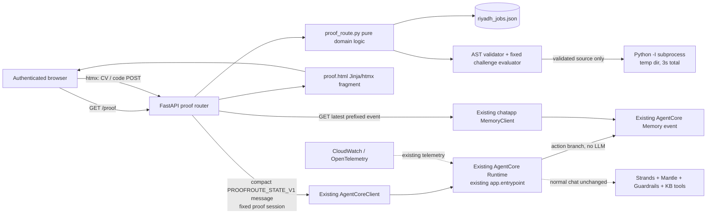

# ProofRoute MVP Design

## Overview

ProofRoute will be a dedicated authenticated `/proof` workflow that proves one closed loop in approximately 2.5 implementation hours:

1. paste CV text;
2. deterministically extract a small canonical skill profile from a local dictionary;
3. compute readiness, job matches, and the highest-impact gap from one local Riyadh/Saudi job dataset;
4. present one fixed **Automated Testing** challenge;
5. evaluate a tightly constrained Python test function against deterministic hidden mutants in a subprocess;
6. transition `Automated Testing` to `Demonstrated` only on a pass;
7. recompute and display before/after score and job matches; and
8. persist the compact snapshot as an AgentCore Memory event through a mode/action branch in the existing agent entrypoint.

The FastAPI application, not an LLM, owns extraction, scoring, matching, challenge definition, pass/fail, and state transition. Bedrock may remain available for the existing chat experience, but it is not on ProofRoute's numeric or evaluation path. No AWS infrastructure, new database, generic code-execution platform, generated challenge, file upload, analytics, or repository/service abstraction is added.

### Scope and requirement feasibility corrections

The approved requirements describe a broader product than can be implemented safely in 2.5 hours. This design uses the following explicit MVP interpretations:

- **Requirements 1, 3, 4, 5, 9, 10, and 12:** one target role (`Junior Backend Engineer — Riyadh`), a small canonical dictionary, one local dataset, one dashboard, and deterministic pure functions.
- **Requirement 2:** local structured JSON is authoritative for frequency/scoring. Existing Bedrock KB remains reusable for future explanations but is not queried by the MVP scoring path; KB document count and ingestion gating are deferred.
- **Requirement 6:** one immutable, hand-authored Automated Testing challenge replaces LLM challenge generation and challenge-per-skill generation.
- **Requirements 7 and 13:** execution is limited to an AST-validated test function in an isolated temporary directory and short subprocess. This is a demo containment boundary, **not** a production-grade hostile-code sandbox.
- **Requirement 8:** only a versioned compact snapshot is persisted as an AgentCore Memory conversational event. Rich semantic/episodic records, retries, and strong write/read timing guarantees are deferred.
- **Requirement 11:** the existing `@app.entrypoint` remains the sole entrypoint. A `PROOFROUTE_STATE_V1:` action prefix is handled before normal Strands/LLM orchestration, using the already verified agent-side Memory client. A second agent/entrypoint would add deployment uncertainty without improving the demo.
- Exact demo numbers `64 → 73` and `8 → 14` are fixture targets, not business invariants. Seed curation should target them, but if tuning exceeds 10 minutes, the cut is to preserve deterministic monotonic improvement rather than spend the MVP budget matching exact marketing numbers.

### Repository research findings

- `chatapp/app/auth/middleware.py` protects every non-public route, so `/proof` receives existing Cognito/dev-mode behavior without new auth code.
- `chatapp/app/templates/base.html` and `components/header.html` already provide theme, Tailwind utilities, htmx, responsive cards, and navigation; ProofRoute needs no new CSS/JS asset.
- `chatapp/app/main.py` owns router registration and app settings injection patterns.
- `chatapp/app/agentcore/client.py` already invokes the sole AgentCore Runtime and parses existing text/tool/guardrail events.
- `agent/my_agent.py` already has a configured `bedrock_agentcore.memory.MemoryClient` and calls `create_event`; `chatapp/app/agentcore/memory.py` already reads events with `list_events`.
- `chatapp/requirements.txt` already includes pytest, pytest-asyncio, and Hypothesis, so no dependency change is needed.
- `cdk/lib/bedrock-stack.ts` already deploys Memory, KB, and Guardrails; `foundation-stack.ts` already grants runtime, memory-read, KB, Cognito, and observability-related access. The MVP adds no resource.

## Architecture



### Architectural decisions

1. **Server-rendered htmx workflow:** each action returns the same `#proof-content` fragment from one Jinja template. No client state framework or custom JavaScript is required.
2. **One compact domain module:** dataclasses, extraction, frequency calculation, scoring, gap selection, matching, fixed challenge, validation, and evaluation stay together because splitting layers would consume the demo budget without reducing risk.
3. **One authoritative dataset:** all market frequency and job-match results derive from `riyadh_jobs.json`; semantic retrieval cannot change numeric output.
4. **Versioned event snapshot:** a compact JSON snapshot prefixed by `PROOFROUTE_STATE_V1:` is written under actor ID = Cognito user ID and fixed session ID = `proof-route-profile-v1`. A new browser session can retrieve the same stream.
5. **No LLM in correctness path:** the state-write action branches before model construction/invocation. Existing normal chat behavior remains unchanged.
6. **Fail closed:** invalid CV, invalid/unsafe code, evaluator failure, or persistence failure never promotes a skill. Persistence failure is displayed as a warning after keeping the current in-request result visible.

## Components and Interfaces

### Domain API (`chatapp/app/proof_route.py`)

The module exposes small typed functions; names are illustrative but form the intended implementation contract:

```python
load_jobs(path) -> tuple[Job, ...]
extract_profile(cv_text, jobs, target_role=TARGET_ROLE) -> SkillProfile
compute_market_frequencies(jobs) -> dict[str, int]
compute_readiness(profile) -> int
select_gap(profile) -> GapSelection | None
match_jobs(profile, jobs) -> tuple[JobMatch, ...]
evaluate_automated_testing(source) -> EvaluationResult
apply_pass(profile, evaluation) -> TransitionResult
snapshot_to_message(snapshot) -> str
snapshot_from_events(events) -> ProgressSnapshot | None
```

Canonical skill extraction uses case-insensitive escaped word/phrase matching against a constant synonym map. A claimed skill is `Demonstrated` only when the same sentence contains a conservative evidence marker (named project/repository URL, role/certification marker, implementation verb, or numeric outcome); otherwise it is `Unverified`. Any dataset skill with frequency at least 40 that is absent is `Missing`. Duplicate synonyms collapse to one canonical skill.

### HTTP interface (`chatapp/app/routes/proof.py`)

- `GET /proof`: load the latest valid snapshot for the authenticated user, or show the CV form.
- `POST /proof/profile`: validate 50–10,000 characters, extract profile, compute score/gap/matches, persist snapshot, and return the content fragment.
- `POST /proof/evaluate`: validate code length 1–10,000, evaluate the fixed challenge, apply transition only on pass, persist outcome/snapshot, and return the content fragment with before/after data.

The router gets `user_id` from `request.state.user`, uses a module-level read-only job tuple, and consumes the existing `AgentCoreClient.invoke_stream(...)` only for the special state-write message. Retrieval uses existing `MemoryClient.get_events(...)`. Endpoints return a complete page for normal navigation and only the `#proof-content` fragment when `HX-Request` is present.

### Fixed challenge and evaluator

The single challenge asks the candidate to write a function with this shape:

```python
def test_normalize_status(normalize_status):
    # candidate assertions
```

The supplied contract says `normalize_status(value)` trims surrounding whitespace, lowercases text, maps `"ok"` to `"passed"`, maps `"error"` to `"failed"`, and rejects non-strings. Candidate code is expected to assert the contract.

Evaluation steps:

1. reject empty or over-10,000-character source;
2. parse with `ast.parse`;
3. require exactly one function named `test_normalize_status` with one parameter;
4. allow only a narrow AST subset needed for assertions, literals, comparisons, boolean expressions, and calls to that parameter; reject imports, attributes, globals, comprehensions, lambdas, classes, async/yield, dunder names, file/network/process access, and arbitrary calls;
5. write a generated harness and candidate function to a `tempfile.TemporaryDirectory` with owner-only permissions where supported;
6. run `sys.executable -I` once with captured stdout/stderr and a 3-second total timeout;
7. inject one correct implementation and fixed hidden mutants (no trim, no lowercase, wrong mapping, no type rejection);
8. pass only when candidate assertions accept the correct implementation and reject every mutant;
9. return structured per-mutant status, bounded output, and a deterministic first-failure hint; and
10. delete the directory automatically on all paths.

This is not a general Python runner. The AST allowlist is the primary MVP control and intentionally limits submissions to assertions over the injected callable. Production execution of hostile code remains deferred to a dedicated isolation boundary.

### AgentCore Memory interface

- Write message: `PROOFROUTE_STATE_V1:{compact-json}`.
- Actor ID: authenticated Cognito user ID.
- Session ID: constant `proof-route-profile-v1` so browser session IDs do not fragment progression.
- Agent behavior: `agent/my_agent.py` detects the prefix before model construction, validates JSON shape/size, calls the already configured `MemoryClient.create_event(...)`, emits an existing text event acknowledgement, and returns.
- Read behavior: the chatapp's existing `MemoryClient.get_events(...)` lists the fixed session; `snapshot_from_events` scans newest-to-oldest user messages, accepts the first valid versioned snapshot, and ignores malformed/unrelated events.
- Stored fields only: target role, canonical skill records, completed fixed challenge outcome, latest score, latest match count, and UTC update timestamp.

Future semantic memory records, per-challenge repositories, direct chatapp writes, migration tooling, and cross-device conflict resolution are deferred.

## Exact File Reuse and Change Map

Every file/component touched or intentionally considered for this MVP is classified below. Estimates are implementation estimates, not design-document time.

| Component / exact file | Classification | Time | Complexity | Risk | MVP treatment |
|---|---|---:|---|---|---|
| Sole runtime entrypoint and state action — `agent/my_agent.py` | **MODIFY existing** | 12 min | Low | Medium | Add an early, prefix-gated state snapshot branch using the existing `_memory_client.create_event`; leave normal agent, tools, MemoryHook, model routing, and streaming unchanged. |
| Proof domain logic — `chatapp/app/proof_route.py` | **ADD new** | 25 min max | Medium | Medium | One compact module for models, extraction, scoring, matching, snapshot codec, and fixed evaluator. If it exceeds 25 min, cut exact demo-number tuning and detailed hints—not deterministic pass/fail. |
| Curated market data — `chatapp/app/data/riyadh_jobs.json` | **ADD new** | 10 min | Low | Low | 12–20 synthetic/curated representative job records with title and canonical required skills; no scraper or ingestion wait. |
| Proof HTTP flow — `chatapp/app/routes/proof.py` | **ADD new** | 20 min | Medium | Medium | Three routes, htmx fragment rendering, existing auth state, existing AgentCore and Memory clients. No service/repository layer. |
| Router registration — `chatapp/app/main.py` | **MODIFY existing** | 2 min | Low | Low | Import and include `proof_router`; no other lifecycle/config changes. |
| Dashboard — `chatapp/app/templates/proof.html` | **ADD new** | 20 min | Low | Low | One template/macro for full page and htmx fragment; reuse base/header/Tailwind. |
| Focused tests — `chatapp/tests/test_proof_route.py` | **ADD new** | 20 min | Medium | Low | Unit + Hypothesis tests for pure logic and fixed evaluator; one lightweight route smoke test only if time remains. |
| Continuity note — `docs/PROJECT_STATE.md` | **ADD new** | 5 min | Low | Low | Record current design decision, scope, files, invariants, and next implementation order. |
| Base theme/htmx shell — `chatapp/app/templates/base.html` | **REUSE unchanged** | — | — | Low | Existing htmx, Tailwind, theme, and responsive tokens are sufficient. |
| Shared header — `chatapp/app/templates/components/header.html` | **REUSE unchanged** | — | — | Low | Include with ProofRoute title/back-to-chat context; no new global navigation required for demo. |
| Cognito/dev auth — `chatapp/app/auth/middleware.py` | **REUSE unchanged** | — | — | Low | `/proof` is protected because it is not public. |
| Runtime invocation — `chatapp/app/agentcore/client.py` | **REUSE unchanged** | — | — | Medium | Send the prefixed snapshot through the existing `prompt` field and fixed runtime session ID; no payload/API extension. |
| Memory event retrieval — `chatapp/app/agentcore/memory.py` | **REUSE unchanged** | — | — | Medium | Existing `get_events` is sufficient; parse the versioned message in the domain module. |
| SSE models — `chatapp/app/models/events.py` | **REUSE unchanged** | — | — | Low | Existing `TextStreamEvent` parsing and `DoneEvent` are sufficient for acknowledgement consumption. |
| Agent configuration — `agent/config.py` | **REUSE unchanged** | — | — | Low | Reuse current Memory ID, region, model, and guardrail variables; add none. |
| Conversation `MemoryHook` — `agent/my_agent.py` existing class | **REUSE unchanged** | — | — | Low | Normal chat memory remains intact; special snapshot branch writes one explicit event before constructing an agent. |
| Bedrock guardrail hook — `agent/guardrails.py` | **REUSE unchanged** | — | — | Low | Continues to cover existing LLM calls; ProofRoute deterministic action makes no LLM call. |
| KB tool — `agent/tools/knowledge_base.py` | **REUSE unchanged** | — | — | Low | Available to normal chat; excluded from scoring/evaluation. |
| Existing app configuration — `chatapp/app/config.py` | **REUSE unchanged** | — | — | Low | No new environment variables. |
| Existing dependencies — `chatapp/requirements.txt`, `agent/requirements.txt` | **REUSE unchanged** | — | — | Low | Hypothesis, pytest, AgentCore, boto3, FastAPI, and Jinja are already present. |
| Existing AWS resources — `cdk/lib/bedrock-stack.ts`, `cdk/lib/foundation-stack.ts`, `cdk/lib/agent-stack.ts`, `cdk/lib/chatapp-stack.ts` | **REUSE unchanged** | — | — | Low | Runtime, Memory, KB, Guardrails, Cognito, CloudWatch/OpenTelemetry, and app deployment are reused. |
| Dedicated ProofRoute agent/entrypoint | **DEFER** | — | — | High | Requirement 11 is reduced to mode/action routing in the one deployed entrypoint; a second entrypoint risks unsupported dispatch/deployment behavior. |
| KB job seed documents and scoring via retrieval | **DEFER** | — | — | High | Avoid ingestion timing and incomplete semantic retrieval. Optional explanatory duplication can follow the demo. |
| New stylesheet or JavaScript asset | **DEFER** | — | — | Low | Existing utility classes and htmx attributes are enough. |
| Repositories/services/database tables/custom analytics | **DEFER** | — | — | Medium | No value for the closed loop; would force infrastructure and abstraction work. |
| General challenge generation and multiple skill challenges | **DEFER** | — | — | High | Fixed Automated Testing challenge only. |
| Production hostile-code sandbox | **DEFER** | — | — | High | Requires a separate isolation boundary and security review; AST-constrained demo evaluator is explicitly non-production. |
| CV upload/OCR, live job scraping, job APIs | **DEFER** | — | — | High | Pasted text and local data only. |
| Strong Memory SLAs, retries, semantic/episodic schemas | **DEFER** | — | — | Medium | Best-effort versioned event snapshot only for MVP. |

Estimated implementation total: **approximately 114 minutes**, leaving roughly 36 minutes for running tests, fixing integration issues, and demo rehearsal. No individual ADD/MODIFY item exceeds 25 minutes.

## Data Models

The implementation should use frozen/regular dataclasses and enums in the single domain module, serialized explicitly to plain JSON-compatible dictionaries.

```text
SkillState = Demonstrated | Unverified | Missing

Job
- id: str
- title: str
- location: str                  # fixed Riyadh/Saudi labels
- required_skills: tuple[str]

SkillRecord
- name: str                      # canonical, non-empty
- state: SkillState
- market_frequency: int          # 0..100
- priority_score: float          # 0..100
- evidence: str                  # <=300 chars for CV, outcome ID after pass, empty if Missing

SkillProfile
- target_role: str
- skills: tuple[SkillRecord]

GapSelection
- skill_name: str
- state: SkillState
- market_frequency: int
- priority_score: float
- rationale: str                 # deterministic template, not LLM text

JobMatch
- job_id: str
- title: str
- coverage: float                # demonstrated required / total required
- matched: bool                  # coverage >= 0.60

TestCaseResult
- name: str                      # correct or hidden-mutant identifier
- status: passed | failed | timeout | error
- detail: str

EvaluationResult
- status: passed | failed | error
- skill_name: str                # always Automated Testing
- cases: tuple[TestCaseResult]
- hint: str
- stdout: str                    # truncated
- stderr: str                    # truncated
- outcome_id: str                # deterministic hash or UUID generated after execution

ProgressSnapshot (schema_version = 1)
- target_role: str
- skills: tuple[SkillRecord]
- completed_challenge: {outcome_id, skill_name, status, updated_at} | null
- latest_score: int
- latest_match_count: int
- updated_at: UTC ISO-8601 string

TransitionResult
- profile: SkillProfile
- previous_score: int
- new_score: int
- score_delta: int
- previous_match_count: int
- new_match_count: int
- demonstrated_skill: str
```

### Deterministic scoring

For market skills with positive frequency:

```text
readiness = clamp(
  round(100 × sum(frequency of Demonstrated skills)
            / sum(frequency of all profile skills with frequency > 0)),
  0,
  100
)
```

If the denominator is zero, return `0`. Canonical deduplication guarantees each skill contributes once. Transitioning one existing skill to `Demonstrated` changes only the numerator, so readiness cannot decrease.

### Deterministic gap selection

For every non-Demonstrated skill with an integer market frequency:

```text
priority = market_frequency × (1.0 if state == Missing else 0.7)
```

Sort by `(-priority, canonical_name.casefold(), canonical_name)` and select the first. If none exist, return `None`. The rationale is a fixed template that names the frequency and state multiplier. Skills lacking frequency are omitted and returned as unscored only in future broader profiles; the local MVP dataset always supplies frequencies.

### Deterministic market frequency and matches

- Frequency: `round(100 × jobs_mentioning_skill / total_jobs)` using the loaded JSON tuple.
- Match coverage: `count(required_skills ∩ demonstrated_skills) / count(required_skills)`.
- A job is matched at coverage `>= 0.60`; zero-skill jobs are invalid seed data.
- Job matches sort by `(-coverage, title.casefold(), id)`; UI shows the first 10.
- Demonstrating a skill can only add to the demonstrated set, so each job's coverage and total matched count are monotonic non-decreasing.

The JSON seed and a fixed demo CV fixture should be curated so Automated Testing is the highest-impact initial gap and ideally yields the `64 → 73`, `8 → 14` showcase. Exact numbers are a seed-fixture concern, not hard-coded branches in scoring.


## Correctness Properties

*A property is a characteristic or behavior that should hold true across all valid executions of a system-essentially, a formal statement about what the system should do. Properties serve as the bridge between human-readable specifications and machine-verifiable correctness guarantees.*

The prework reflection consolidated logically overlapping criteria: evidence-state clauses are one classifier property; frequency/range clauses are one aggregate property; formula/determinism clauses are one scoring property; priority/tie/reproducibility clauses are one selection property; promotion, score diff, and authorization clauses are one transition property; and matching reference/monotonicity clauses are one property. UI, AWS, timing, and production-sandbox claims remain example or integration tests.

### Property 1: Canonical profile derivation is valid and evidence-aware

For all valid CV texts assembled from configured skill synonyms, whitespace/case variants, and sentences with or without evidence markers, extraction produces at most one non-empty canonical record per skill; claimed skills with a same-sentence artifact marker are `Demonstrated`, claimed skills without one are `Unverified`, absent market skills at or above the missing threshold are `Missing`, and every evidence snippet is a substring of the CV bounded to 300 characters.

**Validates: Requirements 1.2, 1.3, 2.3, 3.1, 3.2, 3.3, 3.4, 12.1, 12.3, 12.4, 12.5**

### Property 2: Market frequencies equal the reference percentage

For all non-empty valid job datasets and canonical skills, computed market frequency equals `round(100 × mentioning_jobs / total_jobs)` and is an integer from 0 through 100 inclusive.

**Validates: Requirements 2.2, 2.4**

### Property 3: Readiness equals the weighted reference and is deterministic

For all valid skill profiles, readiness is zero when no positive market weight exists; otherwise it equals the clamped rounded weighted formula in Requirement 4.1, and repeated calls with the same profile return the same value.

**Validates: Requirements 4.1, 4.2, 4.3**

### Property 4: Gap selection follows priority and deterministic ordering

For all valid profiles, gap selection returns `None` exactly when no non-Demonstrated scored skill exists; otherwise it returns the first candidate ordered by descending `market_frequency × state_multiplier` and ascending canonical name, and repeated calls return the same result.

**Validates: Requirements 5.1, 5.2, 5.3, 5.4**

### Property 5: Only passing evidence promotes and promotion cannot lower readiness

For all valid profiles and evaluation results, a non-passing result leaves every skill state and score unchanged; a passing result for the fixed Automated Testing challenge changes only that skill to `Demonstrated`, attaches its outcome ID, recomputes the score, and produces `new_score >= previous_score` with `delta = new_score - previous_score`.

**Validates: Requirements 3.5, 4.4, 7.6, 9.1, 9.4**

### Property 6: Demonstration cannot reduce deterministic job matches

For all valid job datasets, profiles, and valid promotions, every job's demonstrated-skill coverage after promotion is greater than or equal to its previous coverage, and the count of jobs meeting the 60% match threshold cannot decrease.

**Validates: Requirements 9.2, 9.3**

### Property 7: Progress snapshot message round-trip preserves progression

For all valid schema-version-1 progress snapshots, encoding to a prefixed compact message and decoding that message yields an equivalent target role, canonical skill states/evidence, completed challenge outcome, score, and match count; malformed, unrelated, or unsupported-version messages never produce a snapshot.

**Validates: Requirements 3.7, 8.4**

### Property 8: The fixed evaluator is deterministic, bounded, and fail-closed

For all AST-accepted candidate test functions generated from permitted assertions, repeated evaluation against the same correct implementation and hidden mutants returns the same pass/fail classification; `passed` occurs only when the correct implementation is accepted and every required mutant is rejected; all results include the fixed skill name and structured cases; and captured stdout/stderr are each at most 10,000 characters.

**Validates: Requirements 6.4, 7.2, 7.4, 7.5, 13.4**

## Error Handling

| Failure | Behavior | State safety |
|---|---|---|
| CV length outside 50–10,000 | Return an htmx validation fragment; echo submitted text and do not call extraction/persistence. | Existing snapshot unchanged. |
| Dataset missing/malformed/empty | Log server error and show “market data unavailable”; disable profile creation/evaluation. | No guessed score or transition. |
| No extracted claims | Show actionable validation (“include skills/projects”) rather than constructing an empty demo profile. | No persisted replacement. |
| Memory read unavailable | Show a non-blocking load error and CV restart action. | Do not fabricate restored progress. |
| Memory write/action failure | Keep the current response visible with “progress not saved” warning and allow retry/resubmit. | Never claim persistence; no extra promotion occurs. |
| Empty/oversized or syntax-invalid code | Return structured `failed` result without starting subprocess. | Skill remains unchanged. |
| AST policy violation | Return deterministic rejection naming the unsupported construct. | Skill remains unchanged. |
| Subprocess timeout | Kill the process where supported, return `failed/timeout`, truncate output, clean temp directory. | Skill remains unchanged. |
| Subprocess start/non-zero/harness error | Return `error` with bounded stderr and clean temp directory. | Skill remains unchanged. |
| Passing evaluation but snapshot write fails | Display pass and local before/after plus persistence warning. A reload may return the prior snapshot. | No false “saved” status; candidate can retry. |
| Unexpected route exception | Log through existing application/CloudWatch path and return a compact error fragment. | Never transition in exception handlers. |

The MVP deliberately does not promise the original 5/10/30-second service SLAs or three-write retry loop. Pure calculations should complete in milliseconds; runtime/Memory calls use existing client behavior and surface failure. Production retry/idempotency would be a later design.

## Testing Strategy

### Property-based tests

Use the already installed **Hypothesis** library. Each of the eight properties above maps to exactly one test, runs at least 100 generated examples (`@settings(max_examples=100)` or more), and carries a comment in this format:

```python
# Feature: proof-route, Property 3: Readiness equals the weighted reference and is deterministic
```

Generators should build small canonical job sets, unique skill profiles, evidence/no-evidence CV sentences, valid promotions, snapshot records, and only AST-safe candidate assertion templates. Keep subprocess use out of most generated cases: Property 8 may test a pure evaluator policy/oracle over generated assertion specifications and use a small example-based subprocess corpus, avoiding 100 process launches while still validating the universal deterministic contract.

### Example and edge-case unit tests

Keep the example suite intentionally small:

- CV lengths 0, 49, 50, 10,000, and 10,001;
- zero-frequency profile returns readiness 0;
- all skills Demonstrated returns no gap;
- synonym/case/whitespace examples;
- fixed challenge definition contains its contract/examples/pass criteria;
- one adequate candidate rejects all hidden mutants;
- one weak candidate misses a mutant;
- syntax error, forbidden import/attribute, timeout, and mocked subprocess startup failure;
- snapshot scan ignores malformed/newer unrelated messages and restores the latest valid snapshot;
- no-profile page renders only the CV CTA;
- populated/result page exposes three state groups, gap, challenge, per-case result, diff, and top jobs.

### Integration and manual smoke tests

- FastAPI TestClient: unauthenticated `/proof` redirects; dev/authenticated GET returns 200; htmx POST returns the fragment marker.
- AgentCore deployed smoke: write a snapshot under `proof-route-profile-v1`, start a new browser session for the same user, and verify restoration.
- Browser smoke at 1280px: no horizontal scroll, htmx indicator appears during requests, and the closed loop completes.
- Observability smoke: existing runtime logs/traces record the state action; no custom metric/dashboard work.
- Security smoke: temporary directory is removed on pass/fail/error, mode is owner-only where supported, forbidden AST examples never invoke subprocess, and output is bounded.

A full production security claim is explicitly out of scope; passing these tests does not convert the demo evaluator into a multi-tenant sandbox.

## UI Flow

1. **GET `/proof`, no snapshot:** shared header + one card with target role label, CV textarea, live native/inline character count, and “Analyze profile.” No downstream cards render.
2. **Profile response:** replace `#proof-content` with readiness gauge/number, three grouped skill columns (`Demonstrated`, `Unverified`, `Missing`), highest-impact gap/rationale, and top 1–10 job matches.
3. **Challenge:** when Automated Testing is the selected/available gap, show the fixed statement, contract/examples, code textarea, and “Run proof.” If a different gap ranks first, the MVP still highlights it but offers the only challenge as “Prove Automated Testing” with transparent labeling; multi-skill challenge generation is deferred.
4. **Evaluation in flight:** standard `hx-indicator` spinner within the challenge card; the server evaluates once.
5. **Failure:** show overall failed status, per-mutant checks, deterministic hint, and keep the code for editing.
6. **Pass:** show passed status, transition Automated Testing to Demonstrated, before/after score and job-match count, delta, and updated next gap.
7. **New browser session:** GET reads the fixed Memory session and restores the latest valid snapshot; code text itself is not persisted.

The template uses existing responsive grid/card utilities and one scrollable page. It introduces no bespoke stylesheet, JavaScript state machine, modal, editor, chart library, or upload control.

## AWS Service Mapping

| AWS/existing capability | MVP use | Classification |
|---|---|---|
| Cognito + `AuthMiddleware` | Protect page and API routes; actor ID comes from verified user state. | **REUSE unchanged** |
| AgentCore Runtime | Receives the versioned state action through the existing runtime ARN/entrypoint. | **REUSE unchanged** |
| AgentCore Memory | Stores and lists compact conversational snapshot events under fixed proof session. | **REUSE unchanged** |
| Strands agent | Existing chat path remains operational; ProofRoute state action branches before model construction. | **REUSE unchanged** |
| Bedrock Guardrails | Continue unchanged for all existing LLM calls; deterministic ProofRoute calls no model. | **REUSE unchanged** |
| Bedrock Knowledge Base | Remains available for normal agent explanations, but is not authoritative for MVP scoring. | **REUSE unchanged** |
| S3 Vectors / KB source bucket | No ProofRoute seed upload or ingestion dependency. | **DEFER** |
| CloudWatch / OpenTelemetry | Existing logs/traces only; no ProofRoute analytics schema. | **REUSE unchanged** |
| ECS/Lambda app deployment and Agent container | Host existing FastAPI and runtime code changes. | **REUSE unchanged** |
| DynamoDB tables | Not used for ProofRoute progression. | **REUSE unchanged** |
| New queues, tables, buckets, functions, roles, or secrets | Not needed. | **DEFER** |

## Risk and Cut List

| Priority | Risk | Mitigation | Cut trigger / reduced behavior |
|---:|---|---|---|
| 1 | Arbitrary Python cannot be made production-safe in 25 minutes. | Narrow AST allowlist, injected callable only, `-I`, temp directory, 3-second timeout, bounded output. | If safe allowlist is not complete in 20 minutes, accept a structured list of assertions/cases instead of Python source; never ship unrestricted execution. |
| 2 | AgentCore Memory event action/retrieval may differ in deployed SDK behavior. | Use only the already observed `create_event` and `list_events` patterns, fixed session, versioned prefix, visible warning. | If integration takes >20 minutes, keep the loop functional in-request and clearly mark reload persistence unavailable; do not add a database. |
| 3 | Exact `64→73` and `8→14` seed tuning can consume time. | Keep formulas fixed and tune only JSON/demo CV. | Stop after 10 minutes; demonstrate monotonic numeric improvement instead. |
| 4 | Route + htmx partial mechanics can sprawl. | One router, one template macro, whole `#proof-content` replacement. | Return full page responses after POST if fragment rendering costs >20 minutes; functional loop beats polish. |
| 5 | Deterministic extraction may miss natural CV phrasing. | Small disclosed synonym/evidence dictionary tailored to demo persona. | Add only synonyms needed for the demo; no LLM fallback in numeric path. |
| 6 | Automated Testing may not be top gap for arbitrary CVs. | Curate demo CV/data and always label the fixed challenge honestly. | Do not build challenge generation; highlight computed gap and offer the fixed proof separately. |
| 7 | Requirement set implies strong SLAs/retries/rich Memory. | Document reduced event-snapshot semantics and fail closed. | Defer all retries, semantic schemas, conflict handling, and timing claims. |
| 8 | UI polish threatens the closed loop. | Existing base/header/Tailwind only. | Cut gauge graphics to a numeric score + progress bar; cut animations/custom CSS first. |
| 9 | Broad test matrix exceeds 20 minutes. | Prioritize pure function properties, evaluator rejection/pass examples, and one route smoke. | Cut visual automation and deployed Memory automation; retain manual smoke checklist. |

### Hard MVP cut order

If implementation runs late, cut in this order: exact target numbers → visual gauge styling → top-job detail fields → live character-count JavaScript (retain server validation) → persistence retry/polish → agent acknowledgement narration. Never cut deterministic scoring, deterministic gap selection, fixed hidden tests, pass-gated transition, before/after diff, or fail-closed behavior.

## Recommended Implementation Order

1. **0–10 min — seed and contracts:** add `riyadh_jobs.json`; define canonical skills, fixed challenge, and demo CV expected output.
2. **10–35 min — pure domain core:** implement models, extraction, frequency, readiness, gap, matching, transition, and snapshot codec in `proof_route.py`.
3. **35–55 min — constrained evaluator:** implement AST policy, hidden mutants, harness, timeout/output bounds, and known pass/fail checks. Apply the structured-assertions fallback immediately if the security allowlist exceeds the budget.
4. **55–67 min — Memory action:** add the early `PROOFROUTE_STATE_V1:` branch to `agent/my_agent.py`; do not modify normal agent construction or tools.
5. **67–89 min — HTTP integration:** add `routes/proof.py`, fixed proof session persistence/retrieval helpers, validation, and register the router in `main.py`.
6. **89–109 min — one-page UI:** add `proof.html` with htmx whole-content replacement and existing components/utilities.
7. **109–129 min — focused tests:** implement the eight consolidated Hypothesis properties where practical plus evaluator and route edge examples. If time is short, prioritize Properties 3–6 and evaluator fail-closed examples.
8. **129–140 min — integration fixes:** run targeted pytest, syntax/import checks, and one local TestClient loop.
9. **140–150 min — demo rehearsal:** run CV → profile → challenge fail → challenge pass → diff → reload; apply the cut list rather than adding abstractions.

This ordering establishes deterministic business value before UI or AWS integration and preserves a runnable in-request loop even if Memory integration is the only deferred piece.